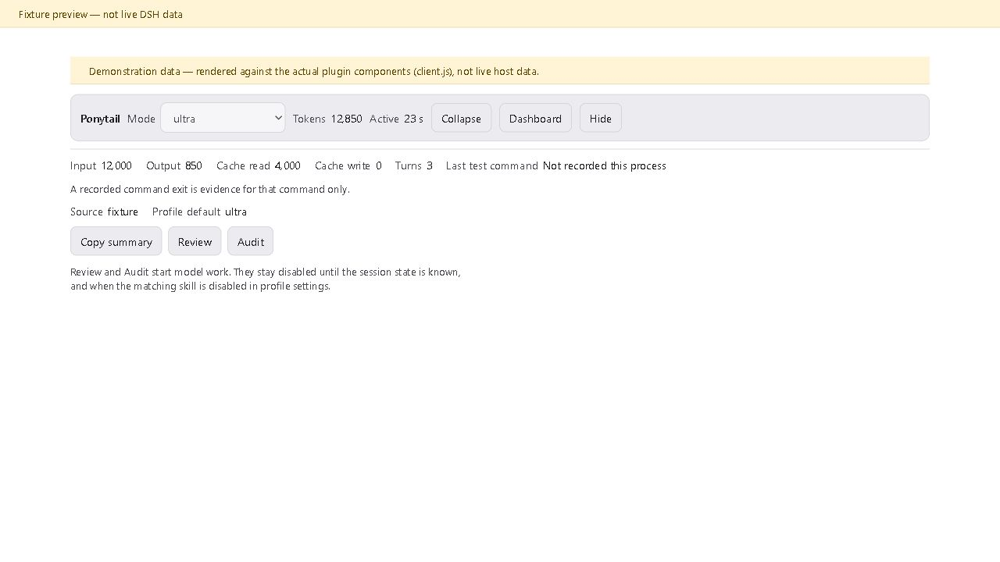
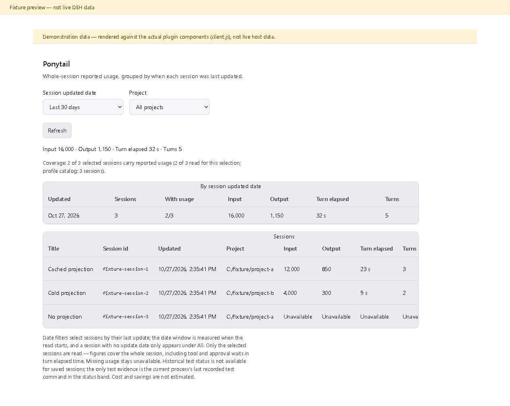

# Ponytail for DeepSeek Harness

An unofficial port of Ponytail 5.3.3 ("lazy senior dev mode") to the DeepSeek
Harness (DSH). It keeps the upstream minimal-code rules exactly as written and
adds native DSH surfaces: a settings tab, a mode picker, a status band in the
composer, and a usage dashboard.

Upstream source: [DietrichGebert/ponytail](https://github.com/DietrichGebert/ponytail)
(MIT). This is an unofficial port, not affiliated with upstream.

**Beta**, tested on Windows with DSH **0.2.1-rc.3**. Other platforms are untested.

## Install

The examples below install into a CLI-managed profile called `web`. They need the
DSH 0.2.1-rc.3 CLI. If you use the desktop app, use its bundled CLI instead (see
"Desktop app" below). Close any running DSH process after installing, then start it
again.

Pick one of four sources:

**Option 1 — Local link (development).** From a checkout of this repository:

```powershell
dsh plugin --profile web add "link:$PWD"
```

The plugin stays linked to your checkout; edits load on the next start.

**Option 2 — GitHub source.** Installs from this repository's source tree:

```powershell
dsh plugin --profile web add github:KB1SLN-Labs/dsh-ponytail
```

Append `#<commit>` to pin a version.

**Option 3 — Release tarball.** Download the packaged file and install it:

```powershell
# https://github.com/KB1SLN-Labs/dsh-ponytail/releases/download/v5.3.3-dsh.5/kb1slnlabs-dsh-ponytail.tgz
dsh plugin --profile web add file:./kb1slnlabs-dsh-ponytail.tgz
```

Save the tarball in a stable folder that will not be deleted — you need it again for
reinstall or upgrade. The URL is version-pinned on purpose: this release is a
prerelease, so a "latest" download link would not resolve to it. To build the same
tarball from a checkout instead, see [Development](#development); the package is plain
JavaScript, so `npm pack` needs no `npm install` first.

**Option 4 — npm (recommended).** Installs the published package:

```powershell
dsh plugin --profile web add @kb1slnlabs/dsh-ponytail
```

Append `@5.3.3-dsh.5` to pin this version.

### Desktop app

The desktop app ships its own CLI. An older globally installed CLI refuses the
reserved `desktop` profile; the bundled one works. Use the bundled CLI with the
`desktop` profile and the ordinary install:

```powershell
$dshDesktop = Join-Path $env:LOCALAPPDATA 'Programs\DeepSeek Harness\resources\runtime\cli\bin\dsh.cmd'
& $dshDesktop plugin --profile desktop add @kb1slnlabs/dsh-ponytail
```

The bundled CLI supports the same alternate sources shown above — `github:`, a
`file:` tarball path, or a local `link:` checkout.

Restart DSH, then open **Settings → Plugins → Ponytail**. Choose a default mode (for
example, `ultra`) and save. The package default is `full`. For details on profile
configuration and migration, see the [adapter reference](docs/REFERENCE.md).

## Everyday use

| Command | What it does |
| --- | --- |
| `/ponytail` | Opens the mode picker (when the UI is available) |
| `/ponytail lite` / `full` / `ultra` / `off` | Sets the mode for this session |
| `/ponytail status` | Shows the current mode and where it comes from |
| `/ponytail reset` | Drops this session's override |

Modes: `lite`, `full` (upstream default), `ultra`, and `off`.

There are also one-shot commands: `/ponytail-review`, `/ponytail-audit`,
`/ponytail-debt`, `/ponytail-gain`, `/ponytail-help`. The review, audit, and other
skill commands start model work. Mode and subcommands like `status` or `help` do
not.

Profile settings survive a restart. Session overrides set with `/ponytail <mode>` reset
when the process restarts. See the [default precedence
reference](docs/REFERENCE.md#config--default-precedence) for environment and global
defaults.

## Screenshots

Both images show **demonstration data** rendered through the actual plugin
components.



*Status band (expanded): Demonstration data.*



*Dashboard: Demonstration data.*

## What the numbers mean

- The dashboard shows whole-session usage as reported by the provider, grouped by
  the date each session was last updated. Filters decide which sessions get read;
  sessions with no update date appear only under **All**.
- Sessions without usable usage are listed as unavailable, and coverage counts say
  how many of the selected sessions carry usage.
- Active time is completed-turn elapsed time and includes waiting on approvals and
  tools.
- The test command shown in the status band is the current process's last recorded
  simple foreground test command. Its exit code is evidence for that command only,
  not proof about a whole suite.
- No cost or savings estimates are made for your sessions. `/ponytail-gain` shows the
  upstream benchmark reference.

Details on history semantics, contracts, and limitations:
[adapter reference](docs/REFERENCE.md), [DESIGN.md](DESIGN.md), [PRODUCT.md](PRODUCT.md).

## Coming from another adapter

If `@mengyuly/dsh-ponytail` is installed, remove that plugin first, then follow the
[migration section of the reference](docs/REFERENCE.md#migration-from-mengyulydsh-ponytail--remove-that-plugin-first-then-replace-its-row)
to replace its override row and keep your settings.

## Development

To run the tests, point `DSH_ROOT` at the directory of an external rc3 host DSH
package install:

```powershell
$env:DSH_ROOT = '<abs path to the @deepseek-ai/dsh package dir>'
npm test        # node --test "test/*.test.mjs" — 64 checks, no model calls
```

See [validation scope](docs/REFERENCE.md#validation-scope) for what has and has not been
verified.

## License

MIT. This port vendors upstream Ponytail (MIT) at a pinned commit; see `LICENSE`
and the [adapter reference](docs/REFERENCE.md) for exact provenance.
